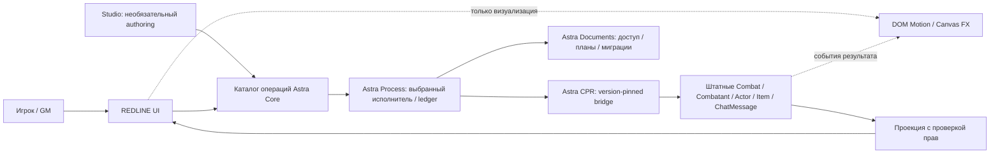
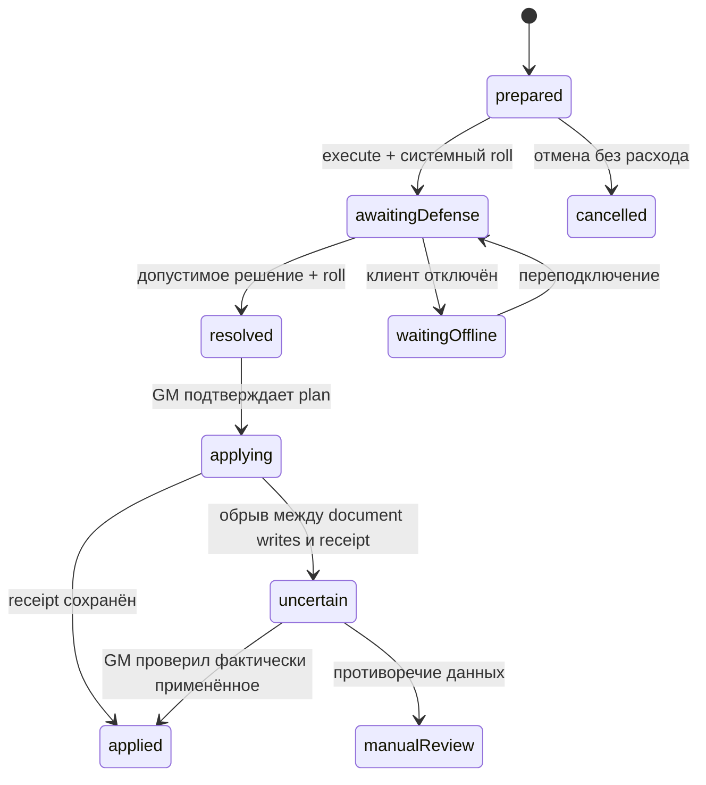

# Astra SDK: конкретная граница первого проекта

## Минимальный состав

Предлагаются **четыре общие runtime-библиотеки**, системный bridge и REDLINE. Это проект разделения, не уже опубликованные шесть пакетов. Только небольшие system-neutral функции прототипированы в `prototype/sdk`; устанавливаемых модулей пока нет. Публикация этого исследовательского репозитория не меняет статус реализации. Пакеты разрешается сначала разрабатывать в одном локальном workspace, сохраняя эти границы API.

| Пакет | Ответственность / зависимости | Что в первом этапе |
|---|---|---|
| `astra-core` | Operation registry, схемы/версии, типизированные результаты, Lifetime, disposer, ошибки. Без Foundry UI и правил | Рабочие JS-примеры `OperationRegistry`, `Lifetime`, generic `createMachine`; полноценная проверка schemas не реализована |
| `astra-ui` | Theme tokens, панели/queue/cards/forms, focus, keyboard, density, per-user layout; bridges для Application и ApplicationV2. Requires core | REDLINE CSS, компоненты панели; общая dialog factory используется досье и кораблём. Application bridges только спецификация |
| `astra-process` | Workflow state, durable request IDs, права/проекции, сроки, журнал, последовательная очередь выбранного исполнителя. Requires core | Pure transition function работает локально. Durable Foundry ledger/authority/reconnect только спецификация |
| `astra-documents` | Document references, permissions, plans, migrations, preview, поддерживаемые изменения и компенсации. Requires core | Требования к Foundry документам; никакого arbitrary HP mutator |
| `astra-cpr` | Pinned API adapter к cyberpunk-red-core; weapon/roll/DV/armor/NET capabilities. Requires core/documents | Интерфейс и перечень проверки; **реального адаптера нет** |
| `redline-combat` | Представление штатного Combat, queue, selected actor, target, contextual workflow. Requires UI/process/documents/CPR | Локальный interactive frontend, демонстрационные данные |

Первый исполняющий клиент не требует Studio. `astra-motion` (DOM), `astra-canvas-fx` (CanvasAnimation/Sequencer bridge), `astra-media`, `astra-diagrams`, `astra-content`, `astra-scene-kit`, `astra-gameplay` и `astra-studio` выделяются **только при появлении второго потребителя и необходимости самостоятельного обновления**. Число 10–15 не критерий приёмки.

## Взаимодействие



Отдельный [SVG](architecture.svg) — читаемая схема. Игровая операция не зависит от завершения эффекта. Стандартный трекер и character sheet доступны как fallback. REDLINE не создаёт параллельный Combat и не хранит истинные HP/броню в своём интерфейсном state.

## Foundry v12: проверенные точки интеграции

Исходные страницы API сохранены в `sources/*.html`. Версия URL — `/api/v12/`; выводы из v13/v14 не использовались вместо них.

| API / первичный источник | Решение |
|---|---|
| [Application](https://foundryvtt.com/api/v12/classes/client.Application.html) | Legacy bridge: defaultOptions/template/getData/activateListeners и close cleanup. Не подменять lifecycle bridge V2 теми же вызовами |
| [ApplicationV2](https://foundryvtt.com/api/v12/classes/foundry.applications.api.ApplicationV2.html), [HandlebarsApplicationMixin](https://foundryvtt.com/api/v12/functions/foundry.applications.api.HandlebarsApplicationMixin.html) | Отдельный bridge, DEFAULT_OPTIONS/actions, documented `_onRender`/`_onClose`; PARTS через Handlebars mixin. Partial updates проверять в доступной v12 сборке; public API, без patch render internals |
| [Combat](https://foundryvtt.com/api/v12/classes/client.Combat.html), [Combatant](https://foundryvtt.com/api/v12/classes/client.Combatant.html) | Читать native turns/round/turn, combatant hidden и document permissions; использовать native nextTurn/rollInitiative при проверенных правах. Не объявлять поддержку записи только по существованию метода |
| [BaseModule](https://foundryvtt.com/api/v12/classes/foundry.packages.BaseModule.html) | В v12 schema присутствуют `library` и `relationships`. `requires` применяется в проверенных manifests Core/CPR. Draft manifest ниже — не валидированный installable package |
| [CanvasAnimation](https://foundryvtt.com/api/v12/classes/client.CanvasAnimation.html) | Именованные анимации + terminateAnimation. DOM переходы через Web Animations/AbortSignal, canvas через свой bridge; выключение effects не отменяет roll |
| [RegionDocument](https://foundryvtt.com/api/v12/classes/client.RegionDocument.html) | Кандидат для scene-kit: документы регионов и предусмотренные behaviors. Не реализован автоматический trigger engine и его совместимость с CPR |
| [JournalEntryPage](https://foundryvtt.com/api/v12/classes/client.JournalEntryPage.html), [ProseMirrorEditor](https://foundryvtt.com/api/v12/classes/client.ProseMirrorEditor.html) | Для content: page sheet registry, правомерная rich text интеграция. Не объявлять, что простой модуль может произвольно расширить type без регистрации/миграций и проверки manifest документальных subtypes |
| [VideoHelper](https://foundryvtt.com/api/v12/classes/client.VideoHelper.html) | Native load/play как будущий media bridge; preload, cancellation и cleanup. Ни media processing, ни постоянный сервер не появляются после установки библиотеки |

Пример **предлагаемого**, не прошедшего Foundry loader manifest общего пакета:

```json
{
  "id": "astra-ui",
  "title": "Astra UI",
  "version": "0.1.0",
  "compatibility": {"minimum":"12.343","verified":"12.343","maximum":"12.999"},
  "library": true,
  "relationships": {"requires":[{"id":"astra-core","type":"module","compatibility":{"minimum":"0.1.0","maximum":"0.1.99"}}]},
  "esmodules": ["dist/astra-ui.mjs"],
  "styles": ["dist/astra-ui.css"]
}
```

`verified` заполнять этим значением **только после реального теста**, пример не утверждает такую проверку. Реестр ошибок должен возвращать `UNSUPPORTED_FOUNDRY` и `UNSUPPORTED_SYSTEM`, а не запускаться с неизвестной версией.

## Системный adapter contract

```ts
interface CprBridge {
  capabilities(): {systemVersion:string; operations:string[]; warnings:string[]};
  readActor(actorUuid:string, viewerId:string): Promise<VisibleActorDTO>;
  readCombat(combatUuid:string, viewerId:string): Promise<VisibleCombatDTO>;
  previewAttack(input:AttackInput, viewerId:string): Promise<AttackPlan | Failure>;
  executeAttack(planId:string, requestId:string): Promise<RollReference | Failure>;
  eligibility(defenderUuid:string, attackKind:string): Promise<DefenseOptions | Failure>;
  executeDefense(requestId:string, choice:string): Promise<RollReference | Failure>;
  previewDamage(requestId:string): Promise<DamagePlan | Failure>;
  applyDamage(planId:string, requestId:string): Promise<ApplyReceipt | Failure>;
}
```

Снимок plan содержит UUID actor/token/item/scene, revision/hash требуемых ресурсов, режим/location, способ дистанции, ID/table source DV, доступные modifiers и **не секретные** warnings. Непосредственно перед execute adapter заново проверяет доступ, actor/item существование, ammo и изменение state. Устаревший plan → `STALE_PLAN`, предложить обновить; не молча изменить подготовленную атаку.

`createRoll` и mixins системы используются через pinned shim. `_applyDamage` и deep imports — **частная интеграция** с тестовой матрицей, feature detection, точной сигнатурой и fail closed. Предпочитать поддерживаемую системную команду/документированную точку, если она доступна; отсутствие такой точки не заменять прямым произвольным HP update. До её проверки `applyDamage` возвращает `ADAPTER_UNVERIFIED` и открывает штатный ручной процесс.

## Машиночитаемые операции

[operations.json](operations.json) содержит version, JSON Schema аргументов/результатов, права, preview, mutation, поддерживаемую компенсацию и status реализации. Каталог содержит операции будущего adapter; это спецификация, а не доступ к игровому миру.

Прототип экспортирует `window.redline.catalog` для inspection. Registry позволяет describe/preview/execute при наличии host.authorize. Registry **не** заменяет проверку schemas, policy или серверную авторизацию: реализация core.js этого пока не делает. Для production нужны validation до маршрутизации и повторно у исполнителя, trusted caller identity, whitelist operations и запрет любых строковых eval/произвольных document paths.

Результат операции: `ok(value, receipt)` или `failure(code, userMessage, recovery, retryable)`. Ошибки различимы: MISSING_DV, EMPTY_MAGAZINE, NO_VISIBLE_TARGET, PERMISSION_DENIED, STALE_PLAN, OWNER_OFFLINE, GM_UNAVAILABLE, ADAPTER_UNVERIFIED, UNCERTAIN_COMMIT. UI не преобразует их в miss/hit.

## Состояния и восстановление



В демо нет applying/uncertain/реальных writes: только prepared → awaiting-defense → resolved → applied. Persisted localStorage не доказывает сетевое восстановление. Deadline не привязан к последнему кадру анимации; отсутствие активного GM означает приостановку, а не надёжный фоновый таймер.

**Источник секретов.** Состояние с attackTotal, hidden actor resources и unrevealed NET data хранить в отдельном GM-only document с native ownership, а не общедоступных Combat.flags. Public projection/whisper recipient содержит только requestId, permitted choice, attacker/target labels в пределах видимости, status и допустимый deadline. Защищающийся не получает численный roll до решения. На уровне транспорта проверяется содержимое network payload и flags, не только отсутствие текста в DOM.

**Ответственный исполнитель.** На первой production итерации один явно выбранный активный GM, последовательная очередь запросов, durable GM-only ledger с requestId/phase/actor revision/receipt. Запрос приходит по маршруту с trusted caller identity; заново проверяется ownership и ожидаемая phase. Несколько активных GM не должны автоматически обрабатывать одну операцию. socketlib — только transport.

Foundry client document updates не объявляются транзакцией или compare-and-swap. Lease/epoch **сами по себе не гарантируют** fencing. Автоматический takeover GM после partial write запрещён до reconciliation. При неопределённости коммита блокировать автоматическое повторное применение и предложить проверку GM. Если требуется строгая гарантия exactly-once при произвольных сбоях/конкуренции — нужен поддерживаемый серверный механизм atomic commit, которого в доступной среде не проверено. Это значимый открытый риск, не замаскированный local Set.

**Компенсации.** Отменить preview можно без побочных эффектов. Отменить pending запрос не означает вернуть потраченный патрон. Для конкретной операции возможен compensating plan с expected post-state и правами GM; если другой процесс менял броню/HP — конфликт и ручной разбор. Универсального undo нет.

## UI-компоненты и переходы

- Queue выделяет active turn жёлтой меткой ▶. Selected actor — голубая метка ◉. Target — красная ⊕. Три состояния независимы и имеют подписи.
- Dock: portrait/identity, hp/SP/status, active weapon/ammo, prepare. Полные stats/skills/roles — контекстные вкладки будущей версии, не постоянные 10 маленьких цифр.
- Attack plan: known/unknown DV, table source и distance confidence, modifiers с происхождением, preview cost. Primary заблокирован с причиной, когда данных нет.
- Defense prompt: только допустимые choices, pending/offline/expired отдельно. Нельзя скрывать result через CSS; projection проверяется у исполнителя.
- Result: roll/target/location/damage breakdown, receipt и применено/не применено. Правила SP/critical effects поступают из adapter, не анимации.
- GM: executor, stale request, missing data, corrective workflow. В demo переключение роли открыто ради просмотра; production будет использовать game.user.isGM/permissions.
- NET: body token остаётся на сцене; раскрытая часть architecture graph/list, программы и фактически доступные действия. Не отображать число неизвестных этажей. Нет пользовательского выдуманного budget.
- Motion: in/out 150 ms в демо; reduced-motion и настройка выключают transition. Reorder queue/deadline animations пока не реализованы. Static PNG не демонстрируют motion.
- Layout: compact/expanded/collapse, scale и сторона panel сохраняются в демо. Произвольное drag docking, touch gestures, восстановление bounds при смене экрана — следующие UI capabilities.

## Два других применения тех же компонентов

[examples.html](prototype/examples.html) — две рабочие локальные демонстрации **тех же импортов** `OperationRegistry`, `createMachine`, `panel`, `Lifetime`.

| Компонент | Интерактивный журнал | База / корабль |
|---|---|---|
| Panel + focus/native dialog | Досье и запрос раскрытия | Контекстный ремонт станции |
| Operation catalog | `journal.reveal(pageId)` | `ship.repair(stationId)` |
| Preview | GM видит content plan, игрок — status | Стоимость 2 energy, остаток без расхода |
| State machine | draft → awaiting-gm → revealed | idle → prepared → completed |
| Document bridge (будущий) | JournalEntryPage ownership/flags | Actor/Item станции и resource ledger |
| Permission projection (будущая) | Не отправлять скрытое содержание игроку | Разделить operator/GM и скрытые повреждения |
| Lifetime | Освободить listeners при закрытии страницы | Остановить UI подписки при смене станции |

Обе модели не импортируют CPR weapons, combat math или canvas fx. Host authorize в примерах явно учебный и допускает действие; настоящие document права не проверялись. Ship energy state не сохраняется, journal не изменяет настоящий JournalEntryPage. Это ограниченная проверка повторного использования интерфейсного API.

## Как покрываются остальные возможности

- Themes/type/icons/localization/a11y — UI: tokens и русский текст сейчас; каталог переводов, schema forms, menus, trees, drag/touch позже.
- DOM motion — motion: cancellable transitions/disposer; canvas particles/rays/camera — FX, не правила.
- Graphs/layout/technology trees — diagrams: раскрытая NET subset и alternative flat; layout engine позже.
- Scene composition/regions/devices/spatial queries — scene-kit поверх native documents; triggers с правами/preview, без бессрочного client scheduler.
- Assets/video/sound groups/crossfade/preload — media; heavy transcoding/speech/3D отдельно.
- Journals/themes/interactive handouts/subtypes/content bundles — content + documents, не monkeypatch rich text.
- Conditions/expressions/branches/time — process: safe expression AST без eval и explicit scheduler capabilities.
- Resources/clocks/jobs/trade/cards/phases/generators — gameplay + adapters; reproducible RNG seed как поддерживаемый feature, не подмена системных dice.
- Migrations/permissions/history/compensation — documents/process; схема и executor до effects.
- API index/scaffolds/lab/visual tests/profiling/cleanup — developer tooling вне клиента игрока.
- Studio — optional editors, compiled declarative plans и operation catalog для агента. Не даёт этому чату автоматически доступ к Foundry.

## План интеграции и приёмка

1. **Sandbox Foundry v12.343 + CPR v0.92.4**, отдельный test world. Нужны лицензированная сборка и multi-user test sessions. Pin compatible socketlib/Core/Diwako, не устанавливать latest. Первичная книга/доступные официальные правила для спорных операций. Ничего не менять в рабочем мире.
2. **Read-only host integration**: actor selection, Combatant visibility/initiative/round, Document hooks, ownership, reload and scene switch. Native tracker остаётся доступным. При unsupported версии показать reason.
3. **Одиночная ranged attack** через штатную системную pipeline. Сравнить sheet и adapter: modifiers, wound/armor penalties, luck, ammo, chat content. Preview должен дать 0 document writes. Cancel не расходует патрон.
4. **Defense transport**: реальный attacker + defender + GM, лог разрешённых DTO, verify hidden total отсутствует в recipient payload/flags. REF eligibility/skill/tie подтверждены; no skill/throw/melee cases не становятся auto-hit.
5. **GM apply**: scope/permissions, requestId ledger, repeated requests, два GM, disconnect во время each write, stale actor revision. Не включать autoapply до прохождения этих тестов. Unknown DV и roll construction errors блокируют урон.
6. **Расширять capabilities**: head/brain/held item, ROF, reload/ammo swap, autofire/suppressive, cover/shields/critical injuries. Unsupported operations остаются manual; UI не обещает автоматизацию.
7. **NET adapter**: rank/action budget, физическое действие, program REZ/derez, Black ICE и revelation. Только проверенные rules paths; hidden floors не передаются.
8. **Пакетирование**: реальный manifests validation, clean installs/migrations, matrix с Evasion/Diwako и отключёнными effects. Notices/licensing before distribution; Studio отдельным пакетом.

Приёмка production: стандартные документы остаются источником истины; одинаковые результаты со штатным sheet; preview не пишет; известный ammo расходуется один раз; unknown не считается hit; unauthorized запрос отвергается у исполнителя; private data отсутствует в полученном player state; replay/reload не удваивают apply; crash-window требует reconciliation; все listeners/timers/effects освобождены; 1920 и 1366/RU/125% пригодны; native fallback доступен. **Эти production-критерии пока не пройдены**.
