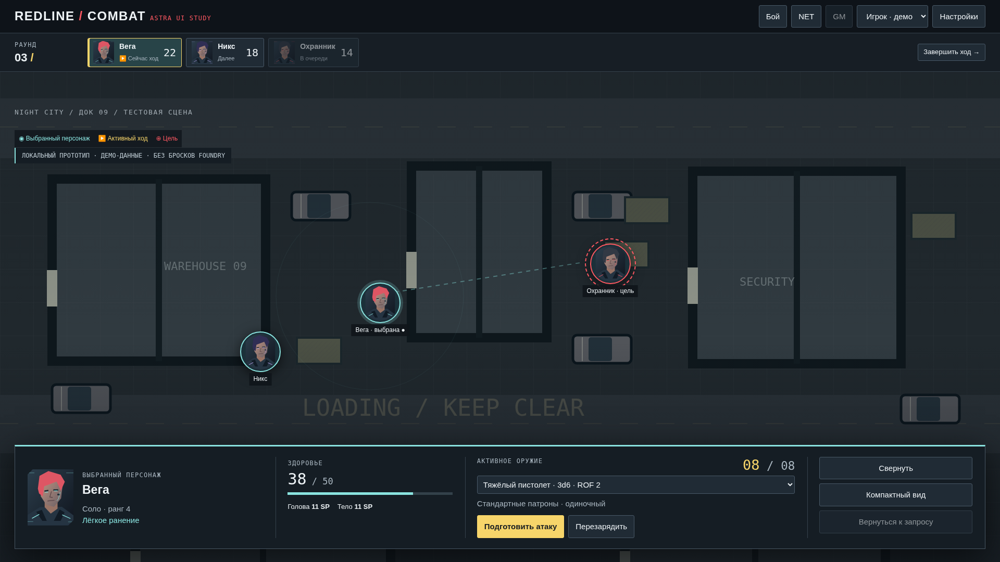

# REDLINE COMBAT / Astra Foundry SDK

Исследование модулей Cyberpunk RED для Foundry v12, новый дизайн боевого интерфейса, браузерный прототип и устанавливаемый **REDLINE COMBAT — Experimental Preview**.

**[Установка модуля](#установка-в-foundry-v12)** · **[Релиз v0.1.1](https://github.com/Defaulter444/CPR-RED-COMBAT/releases/tag/v0.1.1)** · **[Отдельные экраны](renders/)** · [Исследование](RESEARCH.md) · [Архитектура SDK](ARCHITECTURE.md) · [Локальный запуск](#локальный-запуск)



## Установка в Foundry v12

**Add-on Modules → Install Module → Manifest URL:**

```text
https://raw.githubusercontent.com/Defaulter444/CPR-RED-COMBAT/main/distribution/module.json
```

Установите пакет и включите **REDLINE COMBAT — Experimental Preview** в Manage Modules отдельного тестового мира Cyberpunk RED. Поддерживаемый диапазон — **Foundry v12.343–12.999**, система `cyberpunk-red-core`. Выберите свой токен; HUD покажет HP, отслеживаемую броню, оружие и настоящую очередь боя. **Shift+R** или молния в инструментах токенов показывают / скрывают HUD. Учебные атаки открываются кнопкой **«Демонстрационный просмотр»**. Для ручной установки есть [ZIP релиза](https://raw.githubusercontent.com/Defaulter444/CPR-RED-COMBAT/main/distribution/v0.1.1/redline-combat.zip).

HUD читает документы мира; **«Следующий ход»** — явная команда GM стандартному трекеру. Настоящие броски, расход патронов, защита между клиентами, урон и NET automation в этой версии не подключены. Запуск в лицензированной Foundry не выполнялся. [Инструкция и ограничения пакета](foundry/redline-combat/README.md).

## Что можно проверить в браузерном прототипе

Выберите персонажа и цель, откройте подготовку атаки, выполните демо-атаку, выберите защиту, переключитесь в GM и примените учебный результат. Запрос сохраняется после перезагрузки; повторное нажатие в одной вкладке не создаёт второй расход. Настройки позволяют проверить пустой бой, 24 участника, скрытую цель, неизвестный DV, длинные русские имена, масштаб и отключённые анимации.

В [галерее](gallery.html) — семь отдельных экранов на 1920×1080 и 1366×768, реконструкции Combat HUD, Token Action HUD и Evasion Workflow, авторские материалы с подписями. [Досье и ремонт корабля](prototype/examples.html) используют те же небольшие общие компоненты.

**Браузерный сценарий остаётся учебным.** Новый устанавливаемый пакет добавляет чтение данных мира, но адаптера боевых операций и настоящих бросков нет. Значения результатов фиксированы, переключатель GM учебный, localStorage не обеспечивает мультиклиентную авторизацию или транзакции. Рабочий мир пользователя не менялся. Все ограничения и непроверенные операции перечислены в [VALIDATION.md](VALIDATION.md).

## Просмотр прямо в браузере через GitHub Pages

Код опубликован в `main`, но Pages пока не включён: подключённая GitHub-интеграция имеет доступ к push и получила `403 Resource not accessible by integration` при запросе создания Pages. Это отдельное право владельца репозитория.

В [Settings → Pages](https://github.com/Defaulter444/CPR-RED-COMBAT/settings/pages) выберите **Deploy from a branch → main → / (root)** и нажмите **Save**. В корне уже есть `.nojekyll` и стартовый `index.html`; дополнительная сборка не нужна.

После успешного развёртывания GitHub Pages:

- Прототип: `https://defaulter444.github.io/CPR-RED-COMBAT/prototype/`
- Галерея: `https://defaulter444.github.io/CPR-RED-COMBAT/`
- Другие применения SDK: `https://defaulter444.github.io/CPR-RED-COMBAT/prototype/examples.html`

Эти адреса до включения Pages могут возвращать 404. Скриншоты и отчёты доступны на GitHub уже сейчас; локальный запуск ниже работает без Pages.

## Локальный запуск

Нужен Python 3. Никакой сборки или npm для просмотра не требуется.

```sh
git clone https://github.com/Defaulter444/CPR-RED-COMBAT.git
cd CPR-RED-COMBAT
python3 -m http.server 8765
```

Откройте `http://localhost:8765/prototype/` для прототипа или `http://localhost:8765/` для галереи. Не открывайте HTML через `file://`: браузер может блокировать ES modules.

## Материалы

| Файл | Содержание |
|---|---|
| [RESEARCH.md](RESEARCH.md) | Реальные модули, версии, зависимости, лицензии, сравнение manifest/ZIP, конкретные риски Evasion Workflow |
| [ARCHITECTURE.md](ARCHITECTURE.md) | Минимальные библиотеки, системный bridge, права, состояние операций, восстановление и критерии приёмки |
| [operations.json](operations.json) | Машиночитаемый контракт будущих операций; adapter ещё не реализован |
| [sources-lock.json](sources-lock.json) | Точные коммиты изученных внешних репозиториев |
| [sources/verified-artifacts.json](sources/verified-artifacts.json) | Manifest/ZIP evidence и SHA-256 исходных загрузок |
| [prototype/](prototype/) | Исходники интерактивного frontend и небольшие system-neutral примеры SDK |
| [renders/](renders/) | Отдельные PNG; новые концепты и реконструкции различаются именами и подписями |
| [THIRD_PARTY_NOTICES.md](THIRD_PARTY_NOTICES.md) | Источники, авторство и условия внешних материалов |

В `sources/` опубликован выбранный набор первичных материалов для реконструкций и воспроизводимости. Полные внешние репозитории и библиотеки медиа в этот репозиторий не перенесены. К исходникам можно обратиться по зафиксированным Git-коммитам и ссылкам в отчёте.

## Проверки

31 браузерная проверка прототипа и сценарии двух SDK-примеров прошли. Проверки устанавливаемого пакета описаны в [VALIDATION.md](VALIDATION.md). Foundry integration tests не запускались: лицензированная сборка и изолированный тестовый мир не предоставлены.

Для повторения проверок установите Playwright в виртуальную среду, запустите HTTP-сервер из корня репозитория в отдельном терминале, затем:

```sh
python3 -m venv .venv
# Linux/macOS; Windows: .venv\Scripts\activate
. .venv/bin/activate
python -m pip install playwright
python -m playwright install chromium
python validate.py
python validate-examples.py
```

Runner использует системный Chromium, если он доступен, иначе установленный Playwright браузер. `CHROMIUM_PATH` позволяет выбрать бинарник, `REDLINE_BASE_URL` — другой адрес сервера. Результат основной проверки сохраняется в `validation.json`. `python capture.py` повторно снимает экраны.

Для пересборки реконструкций нужен Node.js:

```sh
npm ci --prefix tooling
node reconstruct.cjs
```

Новые исходники SDK — экспериментальная работа. Общая лицензия проекта пока не выбрана; лицензии внешних материалов сохраняются отдельно. Копирование элементов существующих модулей не означает, что их условия распространяются на весь SDK автоматически.


## Сборка устанавливаемого пакета

```sh
python3 build-module.py
node --test tests/module/state.test.mjs
# При работающем HTTP-сервере из корня репозитория:
python3 validate-module.py
```

`dist/` содержит ZIP, manifest и SHA-256. Сборка включает только новые исходники REDLINE и собственные SVG демо; исследованные сторонние модули в ZIP не входят. Browser fixture использует модель публичного API Foundry, а не Foundry server.
