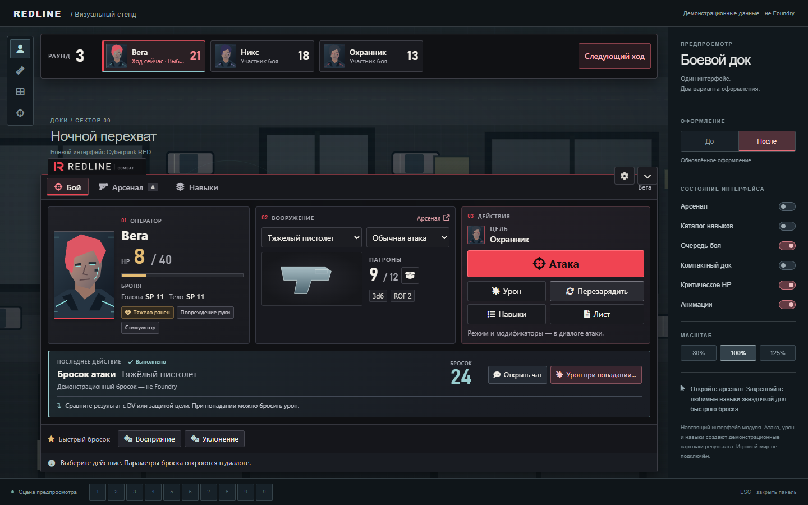
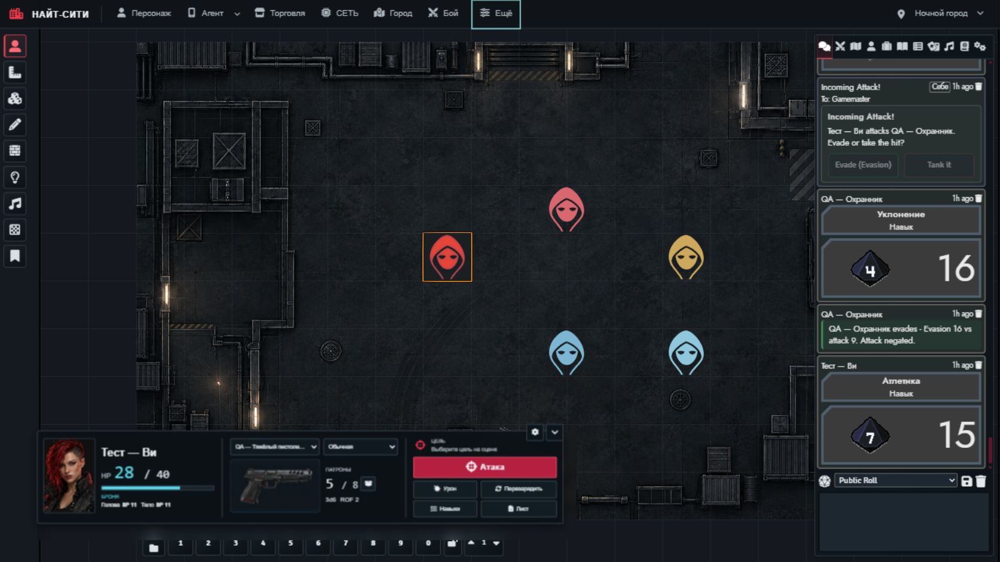

# REDLINE COMBAT

**[REDLINE COMBAT 0.5.0](https://github.com/Defaulter444/CPR-RED-COMBAT/releases/tag/v0.5.0)** — «Неоновая полоса»: широкий док заменён тонкой полосой внизу экрана. Персонаж, HP, броня, оружие и патроны, цель, атака и навыки — в одну строку, подробности — в карточках над элементами, результат броска всплывает и скрывается сам. Масштаб 50–150% меняется перетаскиванием уголка полосы.

Если REDLINE уже установлен, откройте **Foundry Setup → Add-on Modules**, проверьте обновления и обновите **REDLINE COMBAT** до 0.5.0. Повторная установка не нужна; прежний адрес манифеста сохранён:

```text
https://raw.githubusercontent.com/Defaulter444/CPR-RED-COMBAT/main/distribution/module.json
```

[Релиз](https://github.com/Defaulter444/CPR-RED-COMBAT/releases/tag/v0.5.0) · [ZIP для ручной установки](https://github.com/Defaulter444/CPR-RED-COMBAT/releases/download/v0.5.0/redline-combat.zip) · [Проверки](foundry/redline-combat/QA.md) · [Дизайн](docs/superpowers/specs/2026-11-01-neon-strip-design.md)



Совместимость: **Foundry12.331 / Cyberpunk RED Corev0.92.4**. Карточка результата подсказывает следующий шаг и открывает оригинал в чате; попадание подтверждается по правилам игры, урон применяется штатными кнопками системы. [Полная инструкция](foundry/redline-combat/README.md).

## История стабильной версии 0.3.2

**Каталог навыков — 0.3.2, 2026-10-17.** «Навыки» открывает поиск и два списка: разделы листа персонажа слева, их навыки справа. Названия, порядок девяти разделов и состав берутся из той же конфигурации системы и Item персонажа, что использует лист. «Все навыки» показывает полный список, включая пользовательские навыки. Выберите строку и нажмите «Бросить — название навыка»: откроется прежний системный диалог. Стрелки выбирают результат, Enter открывает бросок, Escape закрывает каталог и возвращает фокус. Поиск ограничен текущим разделом; пустой результат отключает бросок. «Другие броски» раскрывает инициативу и спасбросок смерти. Раздел, запрос и выбранный навык хранятся для данного персонажа/токена только в текущем сеансе страницы.

**Проверка 0.3.2:** 119 тестов прошли; в отдельном Foundry 12.331 / CPR 0.92.4 все 63 навыка тестового персонажа совпали с девятью разделами листа. Проверены поиск, клавиатура, отмена и подтверждение штатного броска, 80% и 125% при 1024 × 768. [Снимок каталога](https://github.com/Defaulter444/CPR-RED-COMBAT/blob/main/docs/skills/catalog-preview-final.jpg). Последующие результаты с указанием 0.3.1 и более ранних версий остаются историческими.

**Версия 0.3.2 — Blackglass Dock и каталог навыков**: панель управления персонажем и очередью боя для **Foundry VTT v12** и **Cyberpunk RED Core 0.92.4** (`cyberpunk-red-core`). Нижний боевой док объединяет портрет и состояние персонажа, выбранное оружие и основные команды. По умолчанию он использует масштаб **80%**; размер можно изменить отдельно для своего клиента. REDLINE работает самостоятельно либо вместе с Night City UI 0.3.5. Атаки, урон, боеприпасы, навыки и инициатива используют прежние диалоги и чат системы.

[Релиз v0.3.2](https://github.com/Defaulter444/CPR-RED-COMBAT/releases/tag/v0.3.2) · [Руководство](foundry/redline-combat/README.md) · [История изменений](CHANGELOG.md) · [Примечания к релизу](RELEASE-NOTES.md) · [Исследование](RESEARCH.md) · [Архитектура SDK](ARCHITECTURE.md)



Реальный REDLINE 0.3.1 в изолированном тестовом мире: масштаб 80%, очередь скрыта до начала боя. [Визуальная проверка текущей версии](design-qa.md) и [историческое сравнение 0.3.0 с выбранным концептом](docs/blackglass/comparison.png).

## Установка в Foundry v12

В **Add-on Modules → Install Module → Manifest URL** вставьте прежний адрес модуля:

```text
https://raw.githubusercontent.com/Defaulter444/CPR-RED-COMBAT/main/distribution/module.json
```

Установите пакет, откройте мир Cyberpunk RED и включите **REDLINE COMBAT** через **Manage Modules**. Для ручной установки скачайте [redline-combat.zip v0.3.2](https://github.com/Defaulter444/CPR-RED-COMBAT/releases/download/v0.3.2/redline-combat.zip), остановите сервер и замените папку `redline-combat` в `Data/modules` целиком. Итоговый путь: `Data/modules/redline-combat/module.json`.

Поддерживается **Foundry v12**; текущая живая проверка выполняется на **12.331 / CPR 0.92.4**. Адаптер действий ограничен именно CPR **0.92.4**. Для совместной работы обновите [Найт-Сити — общий интерфейс](https://github.com/Defaulter444/night-city-ui) до **0.3.5**: REDLINE управляет собственными размерами и сворачиванием, а Night City UI добавляет отдельное управление панелью игроков. Перед обновлением рабочей кампании проверьте сборку в отдельном тестовом мире и сохраните предыдущую папку модуля. Foundry, система Cyberpunk RED и данные мира в ZIP не входят.

## Blackglass Dock

Развёрнутая панель разделена на три области:

- **Персонаж:** портрет из листа, имя, HP и броня.
- **Оружие:** выбор экипированного оружия и режима, изображение предмета, патроны, урон и ROF.
- **Действия:** выбранная цель, основная кнопка **«Атака»**, затем **«Урон»**, **«Перезарядить»**, **«Навыки»** и **«Лист»**.

Стрелка в углу дока сворачивает его в компактную полосу: **57 px при масштабе 100%**, около **46 px при значении по умолчанию 80%**. Состояние раскрытия сохраняется для текущего клиента в настройке `dockExpanded`. Выбранное оружие запоминается отдельно для персонажа **только в текущем сеансе страницы**; перезагрузка страницы сбрасывает этот выбор. Выбор оружия в панели не меняет экипировку в листе.

Соседняя **шестерёнка «Настроить размер REDLINE»** открывает настройку масштаба от **55 до 125%**, с шагом **5%**, и сброс до **80%**. Та же настройка доступна в настройках модуля Foundry. Она изменяет док и очередь боя только для текущего клиента. Ширина дока ограничена **1100 px при 100%**, то есть **880 px при 80%**, и дополнительно уменьшается по доступному месту на экране.

**«Навыки»** открывает прокручиваемую область над доком: поиск, разделы листа и навыки; «Другие броски» раскрывает инициативу и спасбросок смерти. Когда между очередью и доком мало места, навыки временно раскрываются поверх дока, сохраняя доступ к очереди и макросам. **Escape** закрывает их и возвращает фокус кнопке **«Навыки»**. Док и очередь пересчитывают отступы по фактическому положению сайдбара, инструментов и макросов Foundry. Видимый таймер DEADLINE сдвигает очередь ниже себя; после его исчезновения очередь возвращается вверх. Без Night City UI REDLINE показывает собственную шапку.

## Как пользоваться

1. Выберите своего токена или доступного участника очереди боя. У игрока также может использоваться назначенный персонаж. **Shift + R** и кнопка REDLINE в инструментах токенов показывают или скрывают панель.
2. Разверните док, выберите экипированное оружие и режим, нажмите **«Атака»**. Откроется штатный диалог Cyberpunk RED с модификаторами; подтверждённая атака расходует боеприпасы по правилам системы.
3. **«Урон»** создаёт системную карточку урона. Применение урона к цели выполняется обычными командами системы в чате; HUD не уменьшает HP или броню цели автоматически.
4. **«Перезарядить»** использует запас из инвентаря, а значок коробки **«Выбрать патроны»** вызывает штатный выбор боеприпасов. Эти команды используют системные `reload` и `load`.
5. Нажмите **«Навыки»**, выберите раздел или **«Все навыки»**, затем нужный навык и кнопку броска. Инициатива доступна для персонажа в текущем бою; спасбросок смерти — при HP ≤ 0.

Очередь показывается **после начала боя** в штатном трекере; один созданный бой или добавленные участники её не включают. Текущий ход и выбранный персонаж — разные состояния. Выбор карточки не меняет очередь; **«Следующий ход»** отправляет отдельную команду GM штатному трекеру. Недоступные действия отключены с объясняющей подсказкой. Во время выполняемой команды кнопки блокируются, чтобы избежать повторного запуска.

Для общей навигации и оформления Foundry можно отдельно установить [Night City UI 0.3.5](https://github.com/Defaulter444/night-city-ui). REDLINE управляет своим доком, масштабом и сворачиванием самостоятельно. Отключение слоя Night City UI оставляет собственную шапку и команды REDLINE доступными.

## Проверки и ограничения

Для **0.3.1 пройдены 99 автоматических тестов REDLINE**; для совместного **Night City UI 0.3.5 — 85 тестов**. Сохраняются API `open`, `close`, `toggle`, `refresh`, `getState`; учебный интерфейс и `openDemo` не возвращаются. Подробности приведены в [QA.md](foundry/redline-combat/QA.md).

В изолированном мире **Foundry 12.331 / CPR 0.92.4**, под Gamemaster при **1672 × 941**, стандартный док 80% занял **880 × 156,36 px** вместо прежних **1288 × 195 px**. При 55% получено **605 × 108,11 px**; значение 125% сохранилось после перезагрузки, сброс вернул 80%. Начало боя с раунда 0 до 1 показало очередь **880 × 64,36 px**; возврат с раунда 1 к 0 убрал её из DOM.

При **1024 × 768**, масштабе **125%** и развёрнутом DEADLINE очередь, док с прокруткой и навыки помещаются между таймером и макросами. Навыки имеют высоту **300 px** и закрываются по Escape. Отмена штатного диалога атаки сохранила **5/8** патронов. В конце проверки восстановлены масштаб **80%** и готовый свёрнутый таймер. Эти проверки не изменяли рабочие кампании.

Историческая база **0.3.0**: прошли **93 автоматических теста REDLINE** и **59 тестов Night City UI 0.3.4**. Следующие живые результаты относятся к этой версии и не подменяют проверку масштаба и новой видимости очереди в 0.3.1.

В изолированном тестовом мире **Foundry 12.331 / CPR 0.92.4** проверен новый интерфейс при **1672 × 941**, **1280 × 720** и **1024 × 768**. Док и раскрытые навыки размещаются между очередью и макросами; при 1024 px навыки прокручиваются, Escape возвращает фокус кнопке открытия. Под Gamemaster обычная атака уменьшила магазин **6 → 5** ровно один раз; защита через Evasion Workflow дала **16 против атаки 9**, проверка Атлетики — **15**. Под Player открывается штатный диалог атаки, его отмена сохраняет **5/8** патронов; выбор чужого НПС и переход хода отключены. Проверены отключение и повторное включение Night City UI и переключение общей темы.

Исторические проверки версий 0.2.0 и 0.2.1 сохранены отдельно в [QA.md](foundry/redline-combat/QA.md). Они охватывают дополнительные режимы оружия, боеприпасы, перезарядку и прежнюю карточку; их размеры не подменяют проверку нового дока. Портреты и изображения оружия берутся из игровых документов; специальные изображения тестовой сцены не входят в модуль. Рабочие кампании не изменялись.

Отдельно проверены свёрнутый и развёрнутый таймер DEADLINE, возвращение очереди вверх после паузы таймера и раскрытие навыков при недостатке места над доком в окне 1024 × 768. Навыки прокручиваются и закрываются по Escape. Подробные измерения приведены в QA.

Ветки ближнего боя и успешного спасброска смерти покрыты автоматическими тестами с моделями системы; отдельного живого сценария для них в этом проходе не было. Нет синхронного запроса защиты между клиентами, автоматического применения урона или NET automation. Одновременные действия разных клиентов подчиняются штатному поведению Foundry/CPR. Foundry v13+, другие версии CPR, мобильные экраны уже 1024 px и произвольные сочетания сторонних модулей не входят в проверенный набор.

Чтобы откатить обновление, отключите REDLINE через **Manage Modules**, остановите сервер и восстановите сохранённую папку предыдущей версии. Не смешивайте файлы разных версий. Откат модуля не отменяет уже выполненные игровые действия, расход патронов или изменения инициативы.

## Исследовательские материалы и браузерный прототип

Репозиторий также хранит исследование Foundry-модулей, архитектуру Astra Foundry SDK и ранний браузерный прототип. **Прототип — исторический учебный сценарий, доступный только из исходников репозитория.** Его HTML, изображения и SDK не входят в устанавливаемый ZIP; в REDLINE нет учебного окна, кнопки или API для его запуска. Результаты, GM-переключатель, защита и NET прототипа не являются возможностями установленного модуля.

[Галерея исторических макетов](gallery.html) и [отдельные экраны](renders/) содержат концепты, реконструкции и демонстрационные данные. [Досье и ремонт корабля](prototype/examples.html) показывают другие применения общих компонентов. [VALIDATION.md](VALIDATION.md) описывает историческую проверку прототипа и раннего пакета; сведения о текущем v0.3.2 приведены выше и в [RELEASE-NOTES.md](RELEASE-NOTES.md).

| Материал | Содержание |
|---|---|
| [RESEARCH.md](RESEARCH.md) | Исследованные модули, версии, зависимости, лицензии и сравнение manifest/ZIP |
| [ARCHITECTURE.md](ARCHITECTURE.md) | Архитектурное исследование системного bridge, прав и состояния операций |
| [operations.json](operations.json) | Исследовательский контракт операций SDK; не описание полной реализации релиза |
| [sources-lock.json](sources-lock.json) | Зафиксированные коммиты изученных внешних репозиториев |
| [sources/verified-artifacts.json](sources/verified-artifacts.json) | Evidence manifest/ZIP и SHA-256 исходных загрузок |
| [prototype/](prototype/) | Учебный frontend и примеры SDK |
| [renders/](renders/) | Исторические концепты и реконструкции с подписями |
| [THIRD_PARTY_NOTICES.md](THIRD_PARTY_NOTICES.md) | Источники, авторство и условия внешних материалов |

В `sources/` находится выбранный набор первичных материалов для воспроизводимости исследования. Полные внешние репозитории и медиабиблиотеки в пакет Foundry не включены. Условия внешних материалов сохраняются отдельно; изучение или реконструкция стороннего интерфейса не распространяет его лицензию на весь проект.

## Разработка

Для запуска учебного прототипа нужен Python 3:

```sh
git clone https://github.com/Defaulter444/CPR-RED-COMBAT.git
cd CPR-RED-COMBAT
python3 -m http.server 8765
```

Откройте `http://localhost:8765/prototype/` или галерею `http://localhost:8765/`. Учебные HTML-файлы следует открывать через HTTP-сервер, а не через `file://`, чтобы браузер мог загрузить ES modules. Владелец репозитория также может включить статический сайт через [Settings → Pages](https://github.com/Defaulter444/CPR-RED-COMBAT/settings/pages); наличие репозитория само по себе не гарантирует развёртывание Pages.

Проверки текущего модуля выполняются из корня репозитория:

```sh
npm test
python3 build-module.py
```

`dist/` содержит ZIP, manifest и контрольные суммы. Исторические `validate.py`, `validate-examples.py` и `validate-module.py` относятся к прототипу и browser fixture; они не заменяют проверку настоящего Foundry.
